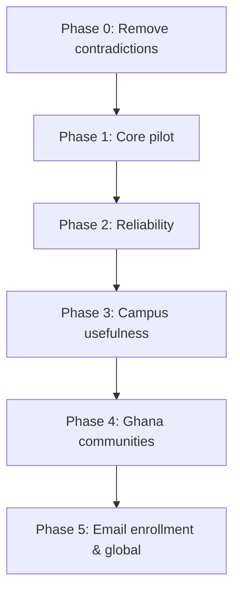

# Campus Pilot Implementation Plan

School-first, offline-capable campus communication. Wider communities are an optional later expansion.

Companion documents: [CAMPUS_PILOT_PROGRESS.md](CAMPUS_PILOT_PROGRESS.md),
[SCHOOL_EMAIL_ENROLLMENT.md](SCHOOL_EMAIL_ENROLLMENT.md), [PRODUCT_DIRECTION.md](PRODUCT_DIRECTION.md).

Everything below about existing code was checked against the tree. Where a phase touches existing code, the
real file and symbol names are used. Items marked **new** do not exist yet — do not plan them as edits.

---

## 1. The three facts

The whole design depends on keeping three facts independent. They have different sources, different
lifetimes, and different failure modes.

| Fact | Means | Source of truth | Does **not** imply |
|---|---|---|---|
| **Verified student** | The school authorized this membership | Signed credential + proof of possession | Anything about location or reachability |
| **On campus** | Available evidence supports physical presence | `CampusPresenceTracker` soft geofence | Membership, or that a message can cross campus |
| **Reachable** | A working network route exists right now | Live transport state | Presence or membership |

**Invariant: no one of these may ever be derived from another.** A mesh connection cannot establish location
or student status; being inside the boundary does not mean a message can cross campus.

Implementation rule: model these as three separately-sourced fields, each carrying its own provenance and
timestamp, and ensure no UI component can render one from another. Phase 0 exists because the code currently
violates this in a live code path.

Soft participation rules are not guarantees. The geofence is evidence, not proof, and does not defend against
modified clients or off-campus relaying. Say so in the UI rather than implying certainty.

---

## 2. Verified baseline

Confirmed present and working:

| Area | Where | State |
|---|---|---|
| Presence engine | `geohash/CampusPresence.kt` | Monotonic time, accuracy-inflated boundary test, replay rejection, exit hysteresis |
| Presence tests | `test/.../CampusPresenceTrackerTest.kt` | 5 tests incl. replayed fixes, uncertain boundary |
| Geofence wiring | `geohash/LocationChannelManager.kt` → `checkSoftGeofences()` | Both campuses from `assets/school_config.json`; 5s expiry loop independent of new fixes |
| Home-screen status | `ui/ChatListScreen.kt` → `CampusPresenceCard` | INSIDE / GRACE / OUTSIDE / UNKNOWN, refresh, permission recovery |
| Channel posting gate | `ui/ChatViewModel.kt` | `#gctu-announcements` requires on-campus `AppMode` **and** Lecturer role |
| Credential model | `identity/SchoolCredential.kt` | Length-prefixed canonical signing bytes, Ed25519, issuer/expiry/revocation checks |
| Credential tests | `test/.../SchoolCredentialTest.kt` | All 9 `Result` states, incl. forged issuer and tampered role |
| DM encryption | `noise/`, `mesh/MeshCore.sendPrivateMessage` | Noise sessions established per peer |
| Blocking | `ui/PrivateChatManager.kt`, `ui/CommandProcessor.kt` | `/block`, `/unblock`, `listBlockedUsers` |
| Delivery ACK path | `mesh/MeshCore.kt` → `MeshDelegateHandler.kt:215` | Real recipient acknowledgement exists |
| Attachments / voice | `mesh/FileTransferManager.kt`, `ui/VoiceInputComponents.kt`, `ui/media/AudioMessageItem.kt` | Present |
| Gateway pairing | `net/GatewayAuth.kt` | Token gates the PWA bridge and OTA endpoints |

Constants (`CampusPresenceTracker`): `MAX_ACCURACY_METERS = 100f`, `FRESH_MS = 60_000`,
`GRACE_MS = 120_000`, `EXPIRY_MS = 180_000`, `EXIT_BUFFER_METERS = 30.0`.

Build floor: `minSdk = 26` (Android 8.0), `targetSdk = 35`. Suite at 140 unit tests, 0 skipped.

### Not implemented — plan as new work

- **Message requests** — no such concept anywhere in the codebase.
- **Trusted campus anchors** — nothing exists.
- **Offline map** — no local tiles, no campus map screen.
- **Administrative-boundary channels** — see Phase 4; the current model cannot express them.
- **Four-section navigation** — `MainActivity` switches screens on boolean state (`showSettings`).
  There is no `NavHost`. `androidx.navigation.compose` is already a declared dependency and unused.
- **Credential storage, enrollment UI, possession exchange** — none wired.

### Already done — do not re-scope

- `LocationChannelManager` already passes `if (location.hasAccuracy()) location.accuracy else null`.
- The 5-second `presenceExpiryJob` already guarantees expiry without a new fix.
- Presence timing already uses `elapsedRealtime()` / `elapsedRealtimeNanos`, so wall-clock tampering is
  already a non-issue **for presence**. It is *not* handled for credentials — see Phase 1.

---

## 3. Enrollment decision: QR for the pilot, email for scale

The pilot enrolls students via **staff-assisted QR**. Email enrollment remains the path to self-service
and is specified in Phase 5, not the pilot.

Rationale — QR removes nearly every external dependency from the critical path:

| | Staff-assisted QR | Email enrollment |
|---|---|---|
| Backend service | none | required |
| Student domain confirmed by school | not needed | blocking |
| Privacy policy rewrite | not needed (no email collected) | required |
| Data-protection posture (Act 843) | minimal | retention, lawful basis, controller |
| Email/hosting provider | not needed | blocking |
| **Works without internet** | **yes** | no |

That last row is decisive: the pilot's success criterion is dependable communication at school without mobile
data, and email enrollment would make the very first step require internet.

> [!IMPORTANT]
> **QR relocates the signing-authority problem, it does not remove it.** Something must still hold the
> Ed25519 issuer private key — a staff-controlled offline device, or a batch of credentials generated offline
> and loaded onto a staff phone. It must never ship in the student app.
>
> Each QR enrollment must be **per-device and single-use**, issuing a real signed credential bound to that
> device's subject key. A shared enrollment code is the "reusable bypass" `SCHOOL_EMAIL_ENROLLMENT.md`
> explicitly rules out.

> [!IMPORTANT]
> **Role tiering.** `SchoolCredentialVerifier` keys trust on `issuerKeyId` and treats `role` as a signed
> field, so the client cannot distinguish a student-issued from a staff-issued credential — it can only trust
> that issuance enforced the rule. Issue Lecturer/Admin under a **separate `issuerKeyId`** so the client can
> enforce it too. Cheap now, painful to retrofit.

> [!WARNING]
> **PII stays off the mesh.** No email, legal name or student number in `SchoolCredential.signingBytes()` or
> any mesh packet. The credential binds only to device subject key, role, school ID and validity window.

---

## 4. Roadmap



---

## Phase 0 — Remove contradictions ✅ DONE

**Objective**: delete code that fabricates the three facts.

**Status: complete.** All items below are implemented; suite at 161 tests, 0 failures, lint clean,
debug and release both compile. Two additional violations of the same class were found while doing it
and are recorded as items 5 and 6.

1. **Delete `updatePeerLocationMock`** — [`assets/web_pwa/app.js:511`](../app/src/main/assets/web_pwa/app.js),
   called from line 263 on *every incoming message*. It plots peers at random ±0.0015° offsets around Tesano
   and assigns a role by string match:
   ```js
   const isLecturer = peerID.includes('Lecturer') || peerID.includes('peer-01');
   ```
   Its own comment says "for presentation wow factor". It fabricates **position** and **role** at once,
   violating three stated rules. Remove the function and its call site; show peers in a list with no position
   until real, explicitly-shared location exists.
2. **Fix premature "Delivered"** — [`ui/MediaSendingManager.kt:408`](../app/src/main/java/com/campusmesh/android/ui/MediaSendingManager.kt#L408)
   sets `Delivered(to = "mesh")` when the *local transfer* completes. That is "I finished sending", not
   "they received it". `Delivered` must come only from recipient acknowledgement, which already works via
   `didReceiveDeliveryAck` → `MeshDelegateHandler.kt:215`. Use `SentToMesh` here instead (Phase 1).
   (The `Delivered` in `NostrDirectMessageHandler.kt:133` is correct — that path constructs an *incoming*
   message.)
3. **Move `createMockAnnouncementPayload`** out of `crypto/RoleAttestationManager.kt` (main source set) into
   test sources, or delete it. A mock announcement signer must not be reachable from production code.
4. **Rename the misleading channel levels** — see Phase 4. As an immediate measure, stop presenting
   `GeohashChannelLevel.REGION` (geohash precision 2, ~1,250 km) as a "region".

5. **Removed fabricated role badges in chat** — `appendChatMessage` derived a role from the sender's
   display name (`sender.includes('Lecturer')`) and labelled every other peer "Student". Any peer could
   award themselves a lecturer badge by renaming, and everyone else was shown as verified membership they
   had never proved. Badges return when a verified credential backs them.
6. **Removed the spoofable "OFFICIAL" emergency alert** — any peer whose message began with `/alert `
   (or arrived on `#gctu-announcements`) triggered a full-screen interrupt on every connected PWA client,
   labelled **OFFICIAL**. The PWA bypassed the lecturer-role and on-campus checks that `ChatViewModel`
   enforces in the Kotlin app, so this was a live campus-announcement impersonation vector. The badge now
   reads UNVERIFIED and the full-screen interrupt is not raised from unauthenticated input; the message
   still appears in the list.

**Exit criteria**: no code path invents a position, a role, or a delivery confirmation. ✅

**Also delivered from Phase 1** (specified and unblocked, so built alongside Phase 0):

- **1e delivery feedback** — `Queued` added, `Sent` → `SentToMesh`, all 9 call sites updated, sealed class
  and its payloads preserved. New `DeliveryStatusTest`.
- **1g spam throttling** — 3 public broadcasts per 10 s per *authenticated* sender, enforced in
  `SecurityManager` after signature verification, with throttled packets deliberately not consuming a dedup
  slot. 4 new tests, including one asserting an attacker cannot burn a victim's budget with spoofed unsigned
  packets. **Neighbour-side limiting is not yet implemented** — it needs `RoutedPacket.relayAddress` plumbed
  through `PacketProcessorDelegate.validatePacketSecurity`, which currently passes only the sender.

---

## Phase 1 — Core pilot

**Objective**: dependable, verified, private communication at school with no mobile data.

### 1a. Enrollment (staff-assisted QR) — partially built

✅ `identity/SchoolIdentityManager` — built and tested.
⏸ QR transport and issuance — **blocked on issuer key custody** (see Open items).

- ~~**new** `identity/SchoolIdentityManager`~~ — generate and store an Ed25519 signing keypair via
  `SecureIdentityStateManager` (already `EncryptedSharedPreferences`-backed). Expose canonical padded-base64
  `subjectSigningKey`. **Distinct from the Noise X25519 transport key — never conflate the two.**
- **new** `identity/enrollment/QrEnrollment` — student displays subject key as QR; staff device verifies
  identity in person, signs a credential, returns it by QR or direct mesh transfer.
- **Credential lifetime: 7–14 days, renewed on contact with a staff device or (later) online.**
  On a mesh a revocation list may never reach a disconnected peer, so revocation cannot be the primary
  control; short lifetime bounds worst-case exposure without depending on delivery. Set
  `SchoolCredentialVerifier(maxLifetimeSeconds = …)` to match. Show renewal state honestly
  (*"Verified · renews in 6 days"*), never a fixed far-future date.
- **Lifecycle from day one**: separate student and staff roles, expiry, lost-phone replacement (revoke old
  credential ID, issue new), and signed revocation updates. Offline devices cannot learn revocations
  immediately — state this in the UI rather than implying certainty.

### 1b. Offline credential verification & possession binding — core built

✅ `identity/PeerVerification` (challenge/response, domain separation, length-prefixed framing,
constant-time nonce compare) and `identity/TrustedTimeFloor` (clock-rollback floor) are built and tested,
including an end-to-end `OfflineVerificationFlowTest` proving a relayed credential passes the certificate
check and fails possession.
⏸ Wiring the exchange into the Noise session as a packet type remains.


**This gates the verified badge. Nothing else does.** A credential is public data; without proof of
possession, anyone who observes a credential blob can replay it and appear verified.

- Over the established Noise session: initiator generates a fresh 32-byte nonce, **retains it**, sends
  `VerificationChallenge(nonce)`. Responder returns `VerificationResponse(credential, proofSignature)` where
  `proofSignature = Ed25519_Sign(domainSeparated("CampusMesh/PeerVerification/v1", sessionHash, nonce))`.
  Initiator rejects any response whose echoed nonce differs from the one it sent — without that check the
  freshness guarantee is decorative.
- **Framing rules, both required**: a distinct domain separator (`SchoolCredential.signingBytes()` already
  prefixes `"CampusMesh/SchoolCredential/v1"` so its signatures cannot be reused elsewhere — the possession
  proof needs its own tag); and length-prefixed fields in fixed order, matching the existing convention
  rather than inventing a second, weaker encoding.
- Verify with
  `SchoolCredentialVerifier.verify(credential, expectedSubjectKey, nowSeconds, revokedCredentialIds)`.
  Field names are **`subjectSigningKey`** and **`issuedAtSeconds`**. Trust comes only from
  `school_config.json`, never from peer-supplied fields.
- **Clock-rollback floor**: `verify()` takes `nowSeconds` from its caller, which traces to a user-settable
  clock — roll the date back and an expired credential validates. Persist a monotonic high-water mark of the
  greatest trusted timestamp seen and refuse any `nowSeconds` below it. Presence already does this;
  credentials need it more.

### 1c. Access rules — channels and DMs differ

- **School channels**: require valid membership **and** sufficient campus-presence evidence. When a student
  leaves, stop *new participation* after the grace period while **preserving downloaded history**.
- **Direct messages**: established conversations continue wherever a usable mesh route exists, including
  off campus. Presence is not a DM precondition. Without a route, queue and explain that delivery is waiting.
  Intermediate devices forward encrypted content without reading it.

### 1d. Direct messages

- **new** message requests — first contact from an unknown peer lands in a request queue, not the inbox.
  This is what makes day-one DMs safe rather than an open harassment channel.
- Blocking already exists; surface it in the conversation UI, not only as a slash command.
- Add per-peer **mute** and a **report** action capturing peer ID and timestamp locally.

### 1e. Delivery feedback

Extend the existing sealed class in
[`model/BitchatMessage.kt`](../app/src/main/java/com/campusmesh/android/model/BitchatMessage.kt) — do **not**
flatten it to an enum. It currently has `Sending`, `Sent`, `Delivered(to, at)`, `Read(by, at)`,
`Failed(reason)`, `PartiallyDelivered(reached, total)`. A flat enum would discard `reason` (needed for
actionable retry) and `PartiallyDelivered` (the only state that can express *reached 3 of 7 peers*).

Add `Queued`; rename `Sent` → `SentToMesh` so it plainly means "handed to ≥ 1 neighbour", not "arrived".
Then update `getDisplayText()` and the **9 files** referencing `DeliveryStatus`: `MessageManager`,
`PrivateChatManager`, `MediaSendingManager`, `MeshDelegateHandler`, `MessageComponents`,
`media/ImageMessageItem`, `media/AudioMessageItem`, `services/AppStateStore`,
`nostr/NostrDirectMessageHandler`. This reaches the Nostr transport path — budget accordingly.

### 1f. Navigation

Introduce **Campus** (announcements, school channels), **Messages** (conversations, requests),
**Explore** (campus map, nearby communities), **Profile** (verification, privacy, connection settings).
This is a real restructure — there is no `NavHost` today — but `androidx.navigation.compose` is already a
declared, unused dependency, so it is wiring rather than a new dependency decision.

### 1g. Spam throttling — at the packet layer

Enforce in `mesh/SecurityManager.kt` / `mesh/PacketProcessor.kt`, **not** `MeshForegroundService.kt`, which
is a lifecycle host and never sees individual packets. `SecurityManager` already holds per-peer state.

- Apply **after** `verifyPacketSignature` succeeds. Keying on an unverified sender ID lets an attacker
  throttle someone else by spoofing their ID — the same ordering mistake that made the dedup cache poisonable.
- Limit the **forwarding neighbour** as well as the author; flood control is about the relay.
- Starting values: 3 public messages / 10 s per authenticated sender; 20 relayed packets / 10 s per neighbour.

**Exit criteria**: two enrolled devices in airplane mode verify each other, exchange DMs with accurate
delivery states, and cannot fake verification by replaying a captured credential.

**Progress**: the verification core (1b) and device identity (1a keypair) are built and tested — 186 tests,
0 failures. What remains in 1a/1b is transport and issuance, both of which depend on the key-custody
decision. 1c–1f are untouched.

---

## Phase 2 — Reliability

**Objective**: prove it works in the buildings students actually use.

1. **Building survey** — walk lecture halls, labs, library. Record delivery rate and hop count per location.
2. **Reconnect behaviour** — kill and restore Bluetooth, Wi-Fi, and the foreground service; confirm queued
   messages drain and presence recovers.
3. **Battery budget** — the usual cause of pilot abandonment. Target **≤ 6% per hour, screen off, 3+ peers
   in range**. Tune `mesh/PowerManager.kt` duty cycles before the trial, not during it.
4. **Queued delivery** — verify a message composed with no route is queued, explained, and delivered on
   reconnect without duplication.
5. **Trusted campus anchors** (**new**) — school-controlled devices supporting presence evidence and
   coverage. **Measure their actual reach before relying on them**; an anchor whose range is assumed rather
   than measured is worse than none, because it makes presence evidence look stronger than it is.
6. **Presence hardening** — Doze/background transitions; permission revocation showing
   *"Location paused • Campus channels are read-only"* with a route to settings.
7. **new** `LocationChannelManagerTest` — geofence polling lifecycle and `AppStateStore` emissions, including
   `ConfigLoader` returning fewer campuses than `AppMode` entries (`campuses.take(modes.size)` truncates
   silently today).
8. **OS matrix — include the real floor.** `minSdk` is **26 (Android 8.0)**, so API 26–28 is supported and
   must be tested. Not hypothetical: a crash in the image-save path (`MediaStore.Downloads` is API 29+)
   reproduced only on API 26–28, the band common on lower-cost Tecno/Infinix handsets. Test
   **API 26/28, 30, 33, 34, 35** across Samsung, Pixel and Transsion hardware.
9. **Multi-hop and density** — A ↔ B ↔ C with A and C out of direct range. State a density target, e.g.
   **8 devices within 30 m**, and measure delivery rate and battery at it.
10. **Gateway pairing walkthrough** — the PWA bridge requires a token from the invite QR in
    `HotspotQrDialog`. Include it in tester instructions or testers will see "Not paired" with no explanation.

**Exit criteria**: measured figures for delivery rate, battery, and anchor reach, recorded against targets.

---

## Phase 3 — Campus usefulness

**Objective**: reasons to open the app daily.

1. **Offline campus map** — package campus buildings and boundaries locally. OpenStreetMap data alone does
   not make the current online map work offline; tiles or vector data must be bundled and rendered by an
   offline renderer. Budget the APK impact.
2. **Map content** — buildings, channel areas, clear selection controls. **No person markers** unless a
   participant has explicitly shared a position. People discovery shows *verified* and *reachable*
   participants; position is a separate, opt-in third fact.
3. **Course groups** — the first real test of repeat usefulness. Pilot before feeds, marketplaces or events.
4. **Lost-and-found**, small attachments, voice notes — `FileTransferManager` and `VoiceInputComponents`
   already exist; this is surfacing, not building from scratch.

**Exit criteria**: map renders with no internet and shows no invented positions; course groups show repeat
weekly usage.

---

## Phase 4 — Ghana communities

**Objective**: place-based channels via Explore, on boundaries that are actually correct.

**This is an architecture change, not a rename.** `GeohashChannelLevel` is `BLOCK(7)`, `NEIGHBORHOOD(6)`,
`CITY(5)`, `REGION(2)` — geohash *precisions*, not administrative units. Precision 2 spans roughly 1,250 km,
covering several countries; presenting it as a "region" is actively misleading.

1. **Administrative boundaries determine channels.** Obtain an authoritative dataset of region, district and
   constituency polygons, and resolve a point by point-in-polygon lookup.
2. **Geohash becomes the index underneath**, not the unit of meaning — a spatial index for fast candidate
   lookup before polygon testing.
3. **Do not force a hierarchy.** Districts are administrative and constituencies are electoral; they do not
   nest cleanly. Model them as parallel lookups against the same point, not levels of one tree. Settlements
   likewise should not be forced into either.

**Exit criteria**: a device in Accra resolves to its actual region, district and constituency, and no channel
name claims an administrative unit it does not represent.

---

## Phase 5 — Email enrollment and global expansion

Only after the pilot succeeds. Both items here carry dependencies the pilot deliberately avoids.

### 5a. Online email enrollment (self-service scale path)

> [!CAUTION]
> **Blocked on a policy rewrite.** [PRIVACY_POLICY.md](../PRIVACY_POLICY.md) states
> **"WE DO NOT COLLECT ANY INFORMATION"** and "We don't collect names, emails, or phone numbers".
> Email enrollment collects and stores student email on a backend. Shipping against that policy is a false
> privacy claim and a Play Data Safety mismatch. Rewrite the policy, update the Data Safety form, and record
> lawful basis, retention period and data controller under Act 843 first.

- `POST /v1/enrollment/challenges` — `{ schoolId, email, subjectSigningKey }` →
  **`{ challengeId, nonce, expiresAt }`**. The nonce must be in the response: the completion proof signs over
  it, and earlier drafts required it while omitting it from the contract.
- `POST /v1/enrollment/complete` — `{ challengeId, code, clientProof }` where
  `clientProof = Ed25519_Sign(domainSeparated("CampusMesh/Enrollment/v1", nonce, subjectSigningKey))`,
  using the same length-prefixed framing as `signingBytes()`.
- Uniform responses; no account enumeration; rate-limited by mailbox, source and challenge; codes and
  addresses never in general logs. Offline or backend-down must fail visibly — never simulate success.
- **The school must confirm** whether those mailboxes identify *current* students. If alumni retain
  mailboxes, access outlasts enrollment. Staff privileges require separate approval regardless.

### 5b. Country and global channels

Internet-backed, with moderation and spam controls designed before launch rather than retrofitted.

---

## 5. Success criteria

The first criterion is **dependable communication at school without mobile data**. Every expansion must
preserve that rather than make it harder to find, understand or maintain.

Pilot thresholds — fix these before recruiting so the trial can conclude rather than merely stop:

- **≥ 20 students, 2 weeks.**
- **Median time to first successful message < 3 minutes.**
- **≥ 60% of participants send on ≥ 3 separate days.**
- **Battery ≤ 6% per hour**, screen off, 3+ peers in range.
- Participants can correctly state **who receives a message** when asked.

Do not collect message content for analytics.

---

## 6. Verification

```bash
./gradlew testDebugUnitTest      # 140 tests, 0 skipped, 0 failures at time of writing
./gradlew lintDebug              # abortOnError=true; new issues fail the build
```

Suites to extend:

- `test/.../geohash/CampusPresenceTrackerTest.kt` — Doze gaps, truncated campus list.
- `test/.../identity/SchoolCredentialTest.kt` — all 9 `Result` states covered; add clock-rollback once the
  time floor lands.
- `test/.../net/GatewayAuthTest.kt` — extend when pairing reaches the map screen.
- **new**: `LocationChannelManagerTest`; a possession-binding test asserting a replayed credential without the
  private key is refused; a delivery-state test asserting `Delivered` is unreachable without a recipient ACK.

Manual geofence testing (emulator) — argument order is **longitude then latitude**:

```bash
./gradlew installDebug
adb emu geo fix -0.2234766 5.5961352   # inside Tesano
adb emu geo fix -0.2388291 5.5995349   # inside Abeka
adb emu geo fix -0.2000000 5.5500000   # off campus
```

---

## 7. Open items

- Custody of the issuer private key for QR enrollment: staff device, or offline-generated credential batch.
- Issuer key rotation procedure and compromise runbook.
- Signed revocation distribution over a partly-offline mesh.
- Authoritative source for Ghana administrative boundary polygons.
- Whether school mailboxes identify current students (blocks Phase 5a only).
- Recovery flow for a lost or factory-reset device.

Until a school-controlled signing authority and trusted configuration exist, keep verification unavailable.
Do not simulate successful enrollment, and never present self-selected roles as verified membership.
